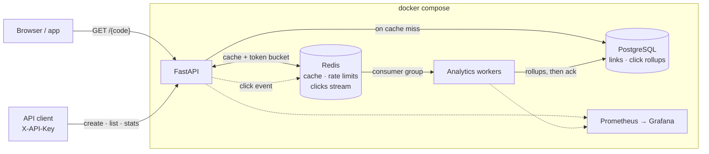

# url-shortener

A URL shortener API with per-key rate limiting, a Redis cache on the redirect path, and an
asynchronous click-analytics pipeline that counts every click exactly once even when workers
crash. Built with FastAPI, PostgreSQL and Redis, monitored with Prometheus and Grafana, and
started with one command through Docker Compose.

## Features

- **Short links** with random 8-character codes or a custom alias, plus optional expiry
- **Fast redirects**: a cached redirect is one Redis read, no database query
- **Link preview**: add `+` to any short link (`/aB3xK9pQ+`) to see where it goes first
- **Bulk create**: up to 50 links in one request, with a result for every row
- **Alias check**: ask whether a custom alias is free before creating it
- **Click stats** per link, by hour or by day
- **Rate limiting** per API key, returning `429` with `Retry-After` and `X-RateLimit-*` headers
- **Monitoring**: request latency, cache hit rate, rate-limit decisions and pipeline lag in Grafana

## Architecture



**Redirects.** The API looks the code up in Redis. On a hit it redirects immediately and
queues a click event in the background. On a miss it reads Postgres once, caches the result
with a slightly randomized TTL (so many keys don't expire at the same moment), and never caches
past the link's expiry. Unknown codes are cached as "not found" for a few minutes so typos and
scanners don't reach the database.

**Rate limiting.** Each API key has a token bucket stored in Redis. Refilling and spending a
token happen in a single Lua script, so concurrent requests can't both take the last token.
If Redis goes down, reads are allowed and writes are rejected with a `503`.

**Analytics.** Click events go into a Redis Stream. Workers in a consumer group read batches,
record each event ID in a `processed_events` table and add the clicks to hourly rollups in the
same transaction, and only acknowledge the batch after the commit. If a worker dies, its
unacknowledged events are reclaimed by another worker, and the event-ID table stops them being
counted twice. Events that can't be parsed go to a dead-letter stream.

More detail on each choice and its tradeoffs: [docs/decisions.md](docs/decisions.md).

## Getting started

Requires Docker. Python 3.11+ is only needed to run the tests outside Docker.

```bash
make up      # api, workers, postgres, redis, prometheus, grafana
make seed    # creates a demo API key (printed once) and 20 sample links
```

Then try it with the printed key:

```bash
export KEY=<printed key>

# create a link
curl -X POST localhost:8000/api/v1/links -H "X-API-Key: $KEY" \
     -H "Content-Type: application/json" \
     -d '{"long_url": "https://example.com/some/long/page", "custom_alias": "demo"}'

curl -i localhost:8000/demo          # 302 to the long URL
open http://localhost:8000/demo+     # preview page

# stats (clicks show up within a few seconds)
curl "localhost:8000/api/v1/links/demo/stats?granularity=hour" -H "X-API-Key: $KEY"
```

| Service | URL |
|---|---|
| API + interactive docs | http://localhost:8000/docs |
| Grafana dashboard | http://localhost:3000 |
| Prometheus | http://localhost:9090 |

## API

| Method | Path | Description |
|---|---|---|
| `POST` | `/api/v1/links` | Create a link (`long_url`, optional `custom_alias`, `expires_at`) |
| `POST` | `/api/v1/links/bulk` | Create up to 50 links; per-row results |
| `GET` | `/api/v1/links` | List your links (`limit`, `offset`) |
| `GET` | `/api/v1/links/{code}` | Get one link |
| `DELETE` | `/api/v1/links/{code}` | Deactivate a link |
| `GET` | `/api/v1/links/{code}/stats` | Clicks by `hour` or `day`, optional `from`/`to` |
| `GET` | `/api/v1/aliases/{alias}` | Is this alias available? |
| `GET` | `/{code}` | Redirect (302) |
| `GET` | `/{code}+` | Preview page, no click counted |
| `GET` | `/healthz`, `/readyz` | Liveness and readiness |

All `/api/v1` routes need an `X-API-Key` header. Keys are stored only as SHA-256 hashes.

## Tests

```bash
python3 -m venv .venv && .venv/bin/pip install -e ".[dev]"
.venv/bin/pytest tests/unit tests/component -q
```

- **Unit tests** cover code generation, URL validation, token-bucket math with a frozen clock,
  and worker helpers.
- **Component tests** run the whole flow in one process (fakeredis with Lua, and SQLite),
  including create → redirect → stream → worker → stats, replaying events without
  double-counting, dead-lettering, and a check that cached redirects make no database queries.
- **Integration tests** run against the real Docker stack:

```bash
SEED_API_KEY=$KEY make itest
```

CI runs lint and the unit and component tests on every push.

## Load testing

```bash
make seed-load   # 10,000 links
make load        # k6: ramps to 500 redirects/s with Zipf-skewed traffic
```

Watch the Grafana dashboard while it runs. Scale the analytics workers with
`docker compose up -d --scale worker=3`.

## Security

- Only `http` and `https` URLs are accepted; URLs with embedded credentials are rejected.
- Links to private, loopback and link-local IPs are blocked, including disguised forms such as
  `http://2130706433/`.
- Click events store only the code and a timestamp: no IP address, user agent or referrer.

## Project layout

```
app/          FastAPI app: routes, cache, rate limiter, models, schemas, metrics
workers/      stream consumer and daily rollup job
migrations/   Alembic migrations
scripts/      seed script
tests/        unit, component and integration tests
load/         k6 load test
monitoring/   Prometheus config and Grafana dashboard
docker/       Dockerfile
docs/         design decisions and architecture notes
```

## Roadmap

- Fallback to Postgres when Redis is down
- Keyset pagination for the links list
- Probabilistic early cache refresh
